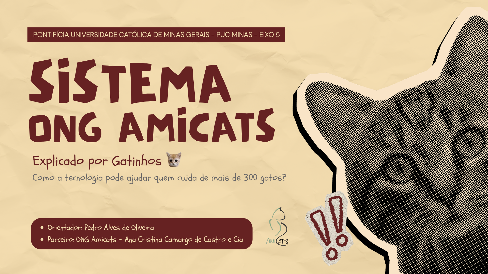

# Apresentação Inicial

Veja os slides da **apresentação inicial** na parte final README.md na raiz do repositório. 
 
Ou baixe em PDF clicando aqui ou na imagem a seguir: [Baixar Apresentação Inicial - PDF.](documentos/img/apresentacao-inicial/APRESENTA%C3%87%C3%83O%20INICIAL%20-%20PROJETO%20ONG%20AMICATS%20-%20COMPRIMIDO.pdf)

# Introdução

A extensão universitária é o processo que articula ensino e pesquisa em uma relação de troca com a sociedade, colocando o conhecimento produzido na universidade a serviço de demandas reais e, no caminho inverso, permitindo que essas demandas reorientem a formação acadêmica. Com a Resolução CNE/CES nº 7/2018 e a meta 12.7 do Plano Nacional de Educação (Lei nº 13.005/2014), a extensão deixou de ser atividade complementar e passou a integrar obrigatoriamente o currículo, respondendo por no mínimo 10% da carga horária dos cursos de graduação. O que se espera dessa mudança não é a prestação de um serviço gratuito, mas uma relação dialógica: a comunidade não é público-alvo passivo de uma solução pronta, e sim parceira que define o problema, valida as decisões e avalia o resultado.

É sob essa perspectiva que se desenvolve o presente projeto. A **ONG Amicats**, organização de proteção animal que abriga mais de 400 gatos resgatados, opera hoje com um controle clínico inteiramente manual — fichas de papel escritas à caneta e afixadas do lado de fora de cada sala do abrigo. Esse arranjo, construído pela própria equipe ao longo dos anos como resposta possível às suas limitações, tornou-se insuficiente diante do volume de animais e da rotatividade de profissionais e voluntários.

O sistema proposto é, portanto, um **sistema sociotécnico**: não se trata de instalar um software sobre um processo existente, mas de reorganizar a forma como pessoas, rotinas e informação se articulam dentro do abrigo. A tecnologia só produz efeito se a equipe — majoritariamente voluntária, sem formação técnica e acostumada ao papel — incorporar o registro digital à sua rotina. Por isso as decisões de projeto foram tomadas junto ao parceiro, considerando suas restrições concretas: ausência de internet fixa, uso exclusivo de celulares pessoais, orçamento praticamente nulo e alta rotatividade de pessoas.

## Problema

A ONG Amicats mantém em uma chácara afastada do perímetro urbano mais de 400 gatos resgatados, alojados em oito salas separadas por condição de saúde (saudável, FIV, FeLV, FIV+FeLV), faixa etária e gravidade clínica. Todo o registro assistencial é feito em fichas de papel presas às portas das salas — arranjo adotado porque a entrada e a saída dos ambientes é restrita, para evitar que os animais escapem.

Da observação do processo atual e da entrevista com as representantes da organização, emergiram quatro dores centrais:

**1. O registro clínico se perde.**

Exames, receitas e anotações de consulta ficam dispersos em papéis avulsos e se extraviam com frequência. Recuperar um tratamento realizado meses antes — qual medicamento, em que dosagem, por quanto tempo e quem prescreveu — depende de busca manual, muitas vezes infrutífera. Um dos exemplos relatados é o de um gato em uso contínuo de analgésico, cujo histórico de medicações anteriores precisa ser consultado a cada reavaliação.

**2. Não há continuidade entre os profissionais.**

Os dois médicos-veterinários contratados atendem em escala alternada — um às segundas, quartas e sextas; outra às terças e quintas — e frequentemente não conseguem conversar pessoalmente. Somam-se a eles três clínicas parceiras externas, cujos prontuários chegam ao abrigo por repasse informal, de pessoa para pessoa. O que ficou pendente em um plantão pode simplesmente não chegar ao seguinte.

**3. Não existe controle de medicações nem de estoque.**

Com grande volume de animais medicados diariamente, não há como confirmar com segurança o que já foi administrado em um turno anterior, nem por que uma medicação foi suspensa. Não há qualquer registro de entrada, validade ou consumo dos medicamentos: a falta só é percebida quando o item acaba — em geral, segundo relato da equipe, em fim de semana, quando a reposição é mais difícil.

**4. Cada consulta exige deslocamento.**

Por ficar distante da cidade, toda ida à chácara representa custo de tempo e combustível. Sem poder consultar as pendências antes de sair de casa, voluntários fazem viagens desnecessárias e compram medicamentos que outro voluntário já havia adquirido.

Agrava esse quadro uma restrição estrutural: **o abrigo não possui internet fixa nem computadores**. O cabeamento é economicamente inviável e a cobertura móvel disponível é instável, o que inviabiliza qualquer solução que dependa de conexão permanente.

## Objetivos

O objetivo geral deste trabalho é **aplicar os conceitos de extensão universitária no desenvolvimento de um sistema sociotécnico que impacte positivamente a comunidade**, por meio da construção conjunta, com a ONG Amicats, de uma plataforma web e mobile que centralize o prontuário clínico, o controle de medicações e a alocação dos animais por sala, garantindo rastreabilidade, acesso simultâneo e consulta remota, com tolerância a conectividade intermitente.

Como objetivos específicos, o grupo se propõe a:

- **Compreender a realidade do parceiro** antes de propor qualquer solução, por meio de entrevista em profundidade e observação do processo em papel, reconhecendo a equipe da ONG como detentora do conhecimento sobre o próprio trabalho.
- **Levantar e validar os requisitos** de forma dialógica, submetendo à organização a estrutura de dados e as funcionalidades propostas, e incorporando os ajustes por ela indicados.
- **Substituir o registro em papel** por um prontuário digital acessível pelo celular, com histórico cronológico, autoria e data/hora em cada lançamento.
- **Viabilizar a continuidade assistencial** entre os veterinários da escala alternada e os profissionais das clínicas parceiras, por meio de um registro comum e consultável.
- **Reduzir deslocamentos e compras duplicadas**, tornando visível remotamente a situação dos medicamentos.
- **Projetar para a restrição real de conectividade**, com salvamento local e sincronização automática ao recuperar a conexão.
- **Entregar uma solução sustentável para a organização**, de baixo custo de operação e operável por voluntários sem formação técnica.
- **Desenvolver, nos integrantes do grupo**, competências técnicas e humanas associadas ao trabalho com um cliente real: escuta, negociação de escopo, comunicação não técnica e responsabilidade sobre o resultado entregue.

## Justificativa

A motivação para este trabalho nasce da constatação de que as dificuldades da ONG Amicats não decorrem de desorganização, mas de escassez. A organização **não recebe qualquer auxílio governamental** e custeia integralmente exames, consultas, medicamentos e internações. Sua equipe é composta por uma administradora, que acumula gestão, finanças e coordenação clínica, dois médicos-veterinários prestadores de serviço, caseiros e um corpo de voluntários com alta rotatividade. Não há funcionários administrativos, nem estrutura de TI, nem verba para contratar uma solução de mercado.

Nesse cenário, cada hora gasta procurando um papel é uma hora que deixa de ser dedicada aos animais, e cada viagem desnecessária à chácara é combustível que sai de um orçamento já apertado. O impacto, porém, não é apenas administrativo: a ausência de registro confiável afeta diretamente a qualidade do cuidado. Não saber qual medicamento foi administrado pela manhã, ou por que uma medicação anterior foi suspensa, cria risco clínico concreto para animais que, em muitos casos, chegaram ao abrigo em estado grave.

Há ainda uma dimensão de conformidade. A Resolução CFMV nº 1.321/2020, alterada pela Resolução CFMV nº 1.653/2025, determina que o prontuário registre data, hora, local, procedimentos realizados e identificação do médico-veterinário responsável com nome e número de CRMV, e seja arquivado, em meio físico ou digital, por no mínimo cinco anos. O modelo atual, baseado em fichas manuscritas afixadas em portas, dificilmente atende a essa exigência de guarda e recuperação.

Soma-se a isso um histórico que a própria organização relatou: **já se tentou, diversas vezes, implantar um controle digital, e todas as tentativas foram abandonadas no meio do caminho**. Esse dado orientou uma decisão importante de projeto — priorizar a Fase 1 nas dores mais urgentes (prontuário e medicações) e projetar uma solução simples o bastante para ser mantida por voluntários após a entrega, em vez de um sistema abrangente que a ONG não conseguiria sustentar.

## Relação com a Extensão Universitária

Este projeto se caracteriza como ação extensionista porque parte de uma demanda apresentada pela própria comunidade, e não de um problema formulado em sala de aula. A ONG participa como parceira em todas as etapas: foi ela quem descreveu a situação-problema, quem validou a estrutura de dados proposta, quem apontou campos a incluir e remover, e quem homologará a solução ao final. A relação é de mão dupla — o grupo contribui com conhecimento técnico, a organização contribui com o conhecimento sobre o próprio trabalho, sem o qual nenhuma das decisões de projeto faria sentido.

**Transformação esperada na realidade do parceiro.**

A implantação do sistema deve produzir efeitos verificáveis: a informação clínica deixa de estar presa a uma folha na porta de uma sala e passa a acompanhar o animal, consultável de qualquer lugar; a passagem de caso entre veterinários deixa de depender de bilhetes e da memória individual; a situação dos medicamentos torna-se visível antes do deslocamento, reduzindo viagens e compras duplicadas; e a organização passa a dispor de um histórico auditável, hoje inexistente, útil tanto para o cuidado clínico quanto para prestação de contas a doadores e parceiros. Indiretamente, o tempo economizado em tarefas administrativas retorna como capacidade de atendimento aos animais.

**Transformação esperada nos estudantes.**

Para o grupo, o projeto substitui o cliente hipotético por um cliente real, com restrições que não podem ser removidas por conveniência: não há como assumir conexão estável, nem orçamento de infraestrutura, nem usuários familiarizados com tecnologia. Isso exige exercitar competências que raramente aparecem em exercícios acadêmicos — traduzir necessidade em requisito sem impor a própria visão, negociar escopo diante de um prazo letivo fixo, comunicar decisões técnicas a interlocutores não técnicos e assumir responsabilidade sobre um sistema que outras pessoas dependerão. Há também uma dimensão formativa de outra ordem: o contato com uma organização que sustenta um trabalho de cuidado com recursos mínimos oferece aos estudantes uma percepção concreta do alcance social da computação, para além do valor econômico das aplicações que costumam desenvolver.

## Descrição do Parceiro

A **ONG Amicats** é uma organização da sociedade civil sem fins lucrativos dedicada ao resgate, tratamento e adoção de gatos. Mantém um abrigo em uma chácara afastada do perímetro urbano, onde estão alojados mais de 400 animais.

**Estrutura física.**

O abrigo é dividido em oito salas, organizadas segundo dois critérios combinados: condição de saúde (saudável, FIV, FeLV, FIV+FeLV) e faixa etária (filhote ou adulto). Paralelamente, há separação por gravidade clínica para os animais em tratamento, incluindo um espaço reservado aos casos mais graves, sob observação mais próxima. Os gatos são realocados com frequência conforme a evolução do quadro. A propriedade não possui internet fixa nem computadores, e a cobertura de rede móvel é instável.

**Equipe.**

A organização não conta com funcionários administrativos. A estrutura é composta pela fundadora, que acumula as funções de administração, finanças e coordenação clínica; dois médicos-veterinários contratados como prestadores de serviço, que atendem no abrigo em escala alternada; caseiros responsáveis pela manutenção; e um corpo de voluntários com alta rotatividade, atuante em limpeza, cuidados, redes sociais, feiras de adoção e captação de recursos.

**Atendimento veterinário.**

Casos leves são tratados no próprio abrigo. Situações que exigem exames especializados, fluidoterapia, internação ou observação por 24 horas são encaminhadas a três clínicas parceiras, com serviços pagos, já que o abrigo não dispõe de consultório nem de veterinário em tempo integral.

**Escopo de atuação.**

A ONG atende exclusivamente os animais que ela própria resgatou, não recebendo gatos de terceiros por limitação financeira e de espaço — limitação que, atualmente, levou a organização a suspender novos resgates. Todo o custeio veterinário é assumido pela instituição, sem qualquer apoio governamental, com sustentação baseada em doações e trabalho voluntário.

**Processo de adoção.**

Conduzido por uma voluntária responsável, envolve entrevista com o interessado, entrega na residência do adotante e acompanhamento pós-adoção por, no mínimo, seis meses. O contrato parte de um modelo base, adaptado conforme a idade e a condição de saúde do animal. A organização mantém ainda parceria com uma rede de pet shops, que expõe parte dos gatos para adoção em loja, mediante protocolo próprio de requisitos sanitários.
