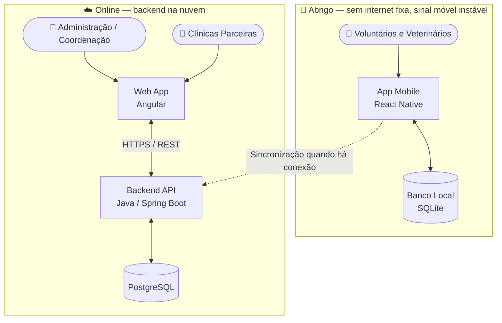
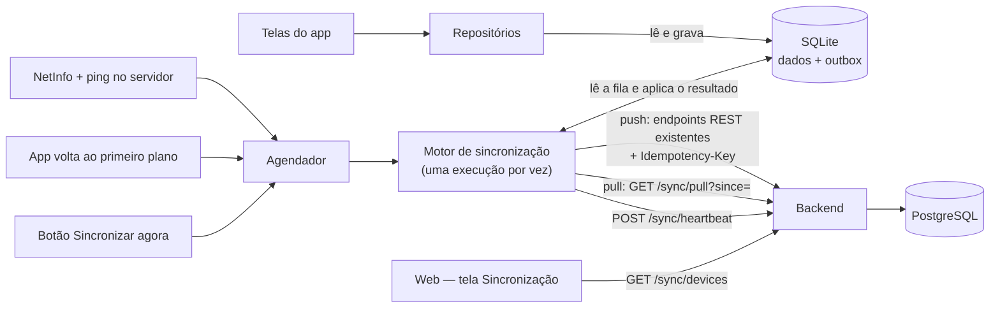
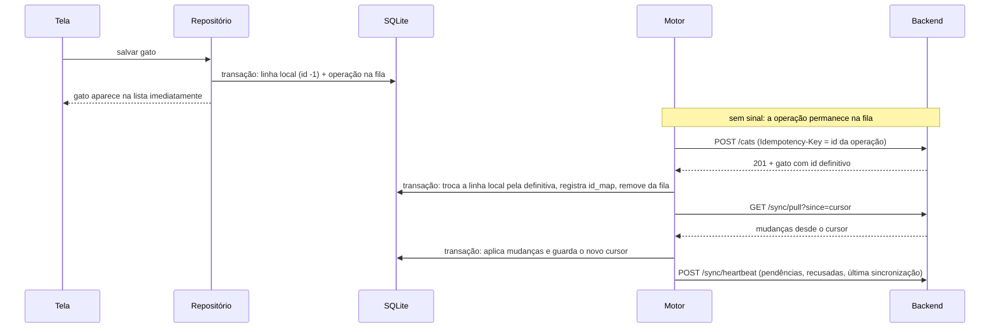
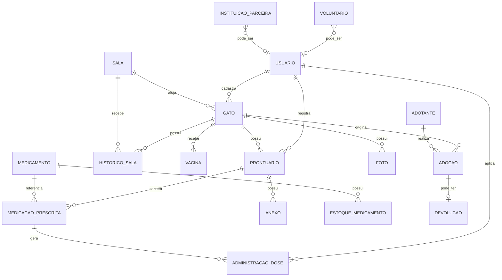

# Especificações do Projeto

A solução proposta para a **ONG Amicats** substitui as fichas de papel afixadas nas portas das oito principais salas do abrigo por um
prontuário digital acessível pelo celular, contemplando ainda o controle de medicações, a alocação dos animais por sala e o ciclo de adoção.
A especificação a seguir foi construída a partir de entrevista em profundidade com as representantes da organização e da observação do
processo manual em uso.

## Usuários

| Tipo de Usuário        | Descrição                                                                                                           | Responsabilidades                                                                                                                                                                               |
|------------------------|---------------------------------------------------------------------------------------------------------------------|-------------------------------------------------------------------------------------------------------------------------------------------------------------------------------------------------|
| **Administrador**      | Fundadora e responsáveis pela gestão do abrigo. Acumulam administração, finanças e coordenação clínica.             | Cadastrar usuários e definir perfis; criar e desativar salas; cadastrar gatos; inserir no sistema os prontuários recebidos das clínicas parceiras; gerar relatórios; acessar todos os módulos.  |
| **Médico-Veterinário** | Profissionais contratados que atendem no abrigo em escala alternada (segundas, quartas e sextas; terças e quintas). | Cadastrar prescrições no prontuário; registrar doses administradas; suspender medicações informando o motivo; agendar e registrar vacinas e castrações; consultar o histórico clínico completo. |
| **Auxiliar**           | Voluntários e caseiros que atuam nos cuidados diários dos animais.                                                  | Consultar fichas, prontuários e situação dos medicamentos; registrar a administração de doses já prescritas; atualizar a sala em que o gato se encontra; cadastrar fotos.                       |
| **Visualizador**       | Colaboradores externos e apoiadores com acesso restrito à consulta.                                                 | Consultar fichas e histórico clínico, sem qualquer permissão de escrita.                                                                                                                        |

## Arquitetura e Tecnologias

A arquitetura foi definida priorizando simplicidade e sustentabilidade de manutenção pela própria ONG, em linha com a restrição de orçamento
praticamente nulo e a ausência de equipe técnica. Não há microsserviços, filas de mensagens ou múltiplos bancos de dados: um único backend e
um único banco relacional atendem os dois clientes (mobile e web). O ponto central do desenho é separar claramente o que precisa funcionar
**offline**, dentro do abrigo, do que funciona **online**, fora dele.

- **App Mobile (React Native)** — usado no abrigo pelos voluntários e veterinários no dia a dia do atendimento. Funciona **offline-first**:
  todo lançamento de prontuário, medicação e alocação de sala é gravado primeiro em um banco local (SQLite) no próprio celular. Quando há
  sinal (mesmo instável), o app sincroniza em segundo plano com o backend, enviando as alterações pendentes e baixando o que foi atualizado
  por outros dispositivos.
- **Backend (Java / Spring Boot)** — fonte única de verdade dos dados. Expõe uma API REST consumida tanto pelo app mobile (via
  sincronização) quanto pela web (uso direto, sempre online). Concentra a lógica de negócio, autenticação e o registro de autor/data-hora
  exigido pela Resolução CFMV nº 1.321/2020.
- **Banco de Dados (PostgreSQL)** — banco relacional único, hospedado na nuvem junto ao backend, armazenando prontuários, medicações,
  estoque e alocação das salas.
- **Web App (Angular)** — utilizado pela administração/coordenação e pelas clínicas parceiras, sempre a partir de locais com internet
  estável (fora do abrigo). Por isso não precisa de suporte offline, apenas de conexão direta e online com a API.
- **Sincronização** — cada dispositivo mobile mantém uma fila local de alterações pendentes; ao reconectar, envia essas alterações ao
  backend e recebe o que mudou desde a última sincronização. Cada registro carrega autor e timestamp, e a resolução de conflitos é feita por
  **acréscimo, nunca por sobrescrita**: um ajuste posterior gera um novo lançamento em vez de substituir o registro existente, preservando o
  histórico auditável exigido para o prontuário e atendendo ao RNF-004 (nenhuma edição silenciosa).

### **Diagrama de componentes:**

### **Estratégia de sincronização:**

Como a chácara não dispõe de conexão estável, o cliente mobile mantém uma **base local** e uma **fila de operações pendentes**. Cada
registro criado offline recebe identificador local e carimbo de data/hora do dispositivo; ao detectar conectividade, a aplicação envia a
fila à API, que aplica as operações e devolve os identificadores definitivos. Um botão de envio manual permite forçar a sincronização.
Conflitos são resolvidos por acréscimo, e não por sobrescrita — coerente com a regra de que nenhum registro clínico pode ser alterado
silenciosamente.

#### Arquitetura da sincronização offline

A sincronização atende RF-016, RNF-002, RNF-004 e UC-21. O princípio é que **o app grava sempre no banco local primeiro**, com ou sem
internet: a conexão só decide *quando* a fila é enviada. Assim existe um único caminho de escrita e de leitura nas telas, em vez de um
caminho "online" e outro "offline" que quase nunca seria exercitado.

**Camadas do app mobile**

| Camada | Responsabilidade |
|---|---|
| Repositórios | Único acesso a dados das telas. Leem do SQLite. Ao escrever, gravam a linha local **e** a operação na fila (`outbox`) na mesma transação, e a interface atualiza na hora. |
| Detector de conexão | O `NetInfo` informa se há rede, mas não se o servidor responde. Por isso, antes de sincronizar, o app faz uma chamada leve ao backend (`GET /error`, rota pública). Estados exibidos ao usuário: sem conexão, sincronizando, aguardando envio, com registros recusados e sincronizado. |
| Agendador | Decide *quando* sincronizar: ao reconectar, ao voltar ao primeiro plano, a cada 60 s com o app aberto, logo após registrar algo e pelo botão "Sincronizar agora". Após falha de rede ou de servidor aplica espera crescente (5 s, dobrando até 5 min, com variação aleatória); o botão manual ignora a espera. |
| Motor de sincronização | Executa **uma sincronização por vez** (chamadas simultâneas compartilham a mesma execução): primeiro envia a fila (push), depois baixa as mudanças (pull) e por fim informa o estado do aparelho (heartbeat), exceto quando não há rede ou a sessão expirou. |
| Banco local (SQLite) | Acesso serializado: toda leitura e escrita passa por uma fila única, e as transações nunca se intercalam. |

**Modelo de dados local (SQLite)**

| Tabela | Conteúdo |
|---|---|
| `outbox` | Fila de operações: `id` (UUID da operação), `type`, `author_user_id`, `payload`, `recorded_at`, `status` (`pending` ou `rejected`), `attempts`, `last_error`, `last_status`. Operação enviada com sucesso é removida. |
| `cache_entities` | Espelho de leitura (gatos, salas, itens de estoque, medicações prescritas) alimentado pelo pull e pelas gravações locais. |
| `sync_state` | Cursor do último pull, identificador do aparelho, horário da última sincronização completa e contador de ids locais. |
| `id_map` | Correspondência entre o id local provisório e o id definitivo devolvido pelo servidor. |

Registros criados offline recebem um **id local negativo**. Como o servidor só gera ids positivos, os dois nunca colidem, e as telas
continuam tratando `id` como número. Depois que o servidor confirma o cadastro, a linha local é substituída pela definitiva e a
correspondência fica em `id_map` — assim uma tela aberta com o id antigo continua encontrando o registro.

**Envio (push) reaproveitando os endpoints existentes**

A fila é enviada **em ordem** (FIFO), uma operação por vez, para os mesmos endpoints REST que a web usa (`POST /cats`,
`PUT /cats/{id}/photo`, `POST /stock/entries`, `POST /cats/{id}/internal-medical-prescriptions`). Isso preserva todas as validações e
permissões que já existem — por exemplo, só veterinário com CRMV prescreve. Cada requisição leva o cabeçalho `Idempotency-Key` com o
UUID da operação.

O `Idempotency-Key` resolve o caso mais perigoso do sinal instável: o servidor grava o registro, mas a resposta se perde. Ao reenviar com
a mesma chave, o backend devolve a resposta original em vez de criar um segundo registro. Operações que dependem de um registro criado
offline (por exemplo, a foto de um gato recém-cadastrado) têm o id local trocado pelo definitivo no momento do envio.

**Como o app trata cada resposta**

| Resposta | Tratamento |
|---|---|
| Sem rede ou tempo esgotado | Para a fila, mantém a operação e registra a tentativa. Tenta de novo no próximo gatilho, com espera crescente. |
| 502, 503, 504, 408, 425 ou 429 | Falha transitória (indisponibilidade): mesmo tratamento da ausência de rede, sem limite de tentativas. |
| 500 | Tratado como transitório nas primeiras tentativas. Após **5 erros 500 consecutivos** a operação é marcada como `rejected`, para que um registro que o servidor nunca consegue processar não trave a fila inteira. A recusa é recuperável: o usuário pode reenviar pelo botão "Tentar de novo". Qualquer outra falha entre as tentativas zera a contagem. |
| 401 | Para a fila **sem consumir** a operação; o app pede novo login. Nada é perdido. |
| Demais 4xx (400, 403, 404, 409, 422) | A operação é marcada como `rejected` com o motivo, **não trava o resto da fila** e aparece na tela de sincronização, onde o usuário pode tentar de novo ou descartar. |
| Operação que depende de um cadastro recusado | Também é recusada, com a mensagem "Depende de um registro que não foi sincronizado". |

Cada item da fila guarda o `author_user_id`, e o servidor registra como autor o dono do token. Por isso a fila de um usuário só é enviada
com a sessão dele: uma operação nunca é gravada em nome de outra pessoa.

**Recebimento (pull)**

`GET /sync/pull?since=<cursor>` devolve gatos, salas, itens de estoque e medicações prescritas alterados desde o cursor. O cursor sai do
**relógio do servidor** (maior `updated_at` devolvido menos 1 minuto de sobreposição), nunca do relógio do celular, para que um aparelho
com a hora errada não perca nem repita mudanças. A sobreposição é segura porque o app aplica as mudanças por substituição (*upsert*).
O servidor só devolve o que o perfil pode ver: itens de estoque são enviados apenas a Administrador, Assistente e Veterinário.

**Conflitos e escopo offline da primeira versão**

Seguindo a regra de que nenhum registro clínico é alterado silenciosamente (RNF-004), o modo offline aceita apenas operações de
**acréscimo**, que não geram conflito de edição:

| Funciona offline | Online somente |
|---|---|
| Cadastrar gato (Administrador e Veterinário); anexar foto ao gato cadastrado (Administrador) | Editar os campos de um gato já existente |
| Registrar prescrição interna\* (a data clínica enviada pelo aparelho, `recordedAt`, vale como data do registro) | Cancelar medicação |
| Registrar entrada de estoque\* | Gestão de usuários e de salas |

\* Operação já suportada pelo motor de sincronização; a tela correspondente no app ainda não existe (ver limitações abaixo).

O servidor aceita `recordedAt` apenas entre 30 dias no passado e 5 minutos no futuro, para que uma dose registrada às 08h não vire 11h por
causa do atraso do envio, sem permitir datas absurdas. A edição de um gato que ainda não foi sincronizado fica bloqueada até o envio.

**Backend**

| Elemento | Descrição |
|---|---|
| Filtro de idempotência | Para `POST`, `PUT`, `PATCH` e `DELETE` com `Idempotency-Key`, reserva a chave por usuário, executa a requisição e guarda a resposta de sucesso. Repetição devolve a resposta guardada com o cabeçalho `Idempotent-Replayed: true`; a mesma chave em outra requisição retorna 422; requisição ainda em andamento retorna 425; erro libera a chave para nova tentativa; uma reserva abandonada (servidor interrompido no meio da requisição) expira em 5 minutos. Chaves são removidas após 30 dias. |
| `updated_at` | Coluna mantida por gatilho do banco (não depende do código) em gatos, salas, itens de estoque e medicações prescritas, com índice. |
| `GET /sync/pull` | Mudanças desde o cursor, filtradas por perfil. |
| `POST /sync/heartbeat` | O aparelho informa identificador, modelo, plataforma, versão, pendências, recusadas e última sincronização. |
| `GET /sync/devices` | Lista de aparelhos para a administração. Somente Administrador. |

**Fuso horário.** O back-end trabalha sempre em UTC: o relógio da aplicação, a sessão do banco e todo `LocalDateTime` trafegado pela API (por exemplo `recordedAt`, `lastSyncAt` e o cursor do pull) representam a hora UTC, sem sufixo de fuso. O mobile envia essas datas em UTC, e web e mobile convertem para o fuso do dispositivo apenas na exibição. Datas de calendário (`LocalDate`, como nascimento e resgate) não sofrem conversão.

**Monitoramento na web**

A tela **Sincronização** (somente Administrador) lista os aparelhos com usuário, perfil, última sincronização, pendências e situação
(Sincronizado, Pendente ou Com recusas), com busca por aparelho ou usuário e atualização automática a cada 60 s. Ela atende ao protótipo
`30-sincronizacao.png`; o app mobile tem a tela correspondente (`14-sincronizacao.png`) com status, fila de pendências e botão
"Sincronizar agora".

**Limitações conhecidas da primeira versão**

- O pull devolve todas as mudanças de uma vez, sem paginação — adequado ao volume do abrigo (centenas de gatos), mas deve ganhar paginação se
  o volume crescer.
- A sincronização só acontece com o app aberto (primeiro plano); não há sincronização em segundo plano com o app fechado.
- A foto aguardando envio permanece no arquivo temporário da câmera/galeria. Se o sistema operacional limpar esse arquivo antes do envio, a
  operação é recusada com a mensagem de arquivo não encontrado e o usuário refaz a foto. O envio de foto é permitido apenas a
  Administrador, regra herdada do endpoint atual.
- As telas de prescrição e de estoque do mobile ainda não existem; as operações correspondentes já estão cadastradas no motor e cobertas por
  testes, e passam a funcionar offline assim que as telas forem criadas.
- O backend ainda não trata violações de unicidade e responde 500 (e não 409) para, por exemplo, microchip duplicado. O app contorna isso
  com a regra dos 5 erros 500 acima, mas o ideal é o backend devolver 409 com mensagem, o que recusa o registro na primeira tentativa.
- O backend limita as requisições a 60 por minuto por IP (`RATE_LIMIT_DEFAULT_CAPACITY`). Vários celulares sincronizando pelo mesmo
  Wi-Fi do abrigo compartilham esse limite; o app trata o erro 429 como transitório e tenta de novo, mas o valor pode precisar de ajuste.
- A coluna "Detalhes" do protótipo da tela web (visualizar a fila de um aparelho) não foi implementada.

> 🚧 **Pendente de definição pela equipe:** linguagens, frameworks e provedores de nuvem. A escolha deve observar a restrição orçamentária da
> organização, privilegiando camadas gratuitas e tecnologias de baixo custo de manutenção.

| Camada                   | Tecnologia                             |
|--------------------------|----------------------------------------|
| Aplicação mobile         | *a definir*                            |
| Painel web               | *a definir*                            |
| API                      | REST — *linguagem/framework a definir* |
| Banco de dados           | Relacional — *SGBD a definir*          |
| Armazenamento de imagens | *a definir*                            |
| Hospedagem               | Camada gratuita                        |
| Versionamento            | Git · GitHub                           |

## Project Model Canvas

| Bloco              | Conteúdo                                                                                                                                                                                                                                                     |
|--------------------|--------------------------------------------------------------------------------------------------------------------------------------------------------------------------------------------------------------------------------------------------------------|
| **Justificativas** | Registro clínico em papel que se perde; ausência de continuidade entre veterinários da escala alternada; falta de controle de medicações e estoque; deslocamentos e compras duplicadas; exigência de guarda de prontuário pela Resolução CFMV nº 1.321/2020. |
| **Objetivo SMART** | Entregar, até 06/12/2026, um sistema web e mobile em produção na ONG Amicats, com prontuário digital, controle de medicações e alocação por sala operando offline.                                                                                           |
| **Benefícios**     | Rastreabilidade do histórico clínico; continuidade assistencial entre profissionais; redução de viagens e compras duplicadas; histórico auditável para prestação de contas.                                                                                  |
| **Produto**        | Aplicação mobile, painel web e API REST, com base de dados centralizada em nuvem.                                                                                                                                                                            |
| **Requisitos**     | Ver seção Requisitos.                                                                                                                                                                                                                                        |
| **Stakeholders**   | Fundadora e administração da ONG; médicos-veterinários contratados; voluntários; clínicas parceiras; adotantes; equipe de desenvolvimento; docente orientador.                                                                                               |
| **Equipe**         | Seis estudantes de ADS, organizados segundo papéis inspirados no Scrum.                                                                                                                                                                                      |
| **Premissas**      | Disponibilidade da ONG para validação periódica; uso de celulares pessoais dos voluntários; existência de ao menos janelas intermitentes de conexão.                                                                                                         |
| **Restrições**     | Ver seção Restrições.                                                                                                                                                                                                                                        |
| **Riscos**         | Baixa aderência da equipe do abrigo ao registro digital; perda de dados antes da sincronização; rotatividade de voluntários; prazo letivo fixo.                                                                                                              |
| **Entregas**       | Documentação e requisitos (Etapa 1); autenticação e gestão de usuários (Etapa 2); cadastros base e núcleo clínico (Etapa 3); adoção e gestão (Etapa 4); homologação e implantação (Etapa 5).                                                                 |
| **Custos**         | Baixo custo operacional; desenvolvimento acadêmico sem contratação; ferramentas e hospedagem gratuitas ou de baixo custo.                                                                                                                                    |

## Requisitos

As tabelas que se seguem apresentam os requisitos funcionais e não funcionais que detalham o escopo do projeto.

**Técnica de priorização aplicada — MoSCoW.** Os requisitos foram classificados em quatro categorias a partir das dores relatadas pela
organização e da dependência técnica entre funcionalidades:

- **Must Have (ALTA)** — sem estes o sistema não resolve o problema que motivou o projeto. Reúne autenticação e perfis, cadastros base,
  prontuário, administração de medicamentos e operação offline. Corresponde ao que a ONG identificou como mais urgente: substituir o papel
  na parede e viabilizar o registro dentro do abrigo, onde não há conexão.
- **Should Have (MÉDIA)** — agregam valor relevante, mas o sistema entra em operação sem eles. Reúne adoção, devolução, vacinas, banco de
  voluntários, registro de atendimento em clínica externa, controle de disponibilidade de medicamentos, instituições parceiras e dashboard.
- **Could Have (BAIXA)** — desejáveis, implementados apenas se houver folga de cronograma. Reúne exportação de relatórios.
- **Won't Have** — explicitamente fora do escopo desta versão, registrado na tabela de Restrições: assistente por IA ou chat para consulta
  de dados, acesso direto de profissionais externos e controle de estoque de ração e insumos.

A **complexidade** foi estimada pela equipe considerando esforço de implementação, volume de regras de negócio e dependência de
infraestrutura externa.

### Requisitos Funcionais

| ID     | Descrição do Requisito                                                                                                                                                                       | Prioridade |  Etapa Programada |   Responsável   | Complexidade |        Concluído em:       |
|--------|----------------------------------------------------------------------------------------------------------------------------------------------------------------------------------------------|:----------:|:-----------------:|:---------------:|:------------:|:--------------------------:|
| RF-001 | Permitir autenticação de usuários por login e senha, gestão completa de usuários, gestão dos seus aceites de termos e recuperação de senha por e-mail ou redefinição pelo Administrador      |    ALTA    |      Etapa 2      |    **Todos**    |    Média     |         Etapa 2 (Ok)       |
| RF-002 | Cadastramento de perfis de acesso distintos (Administrador, Médico-Veterinário, Auxiliar e Visualizador) com permissões próprias                                                             |    ALTA    |      Etapa 3      | Railan e Aliane |     Alta     |     Etapa 2 (Antecipado)   |
| RF-003 | Permitir o cadastro do banco de contatos voluntários                                                                                                                                         |   MÉDIA    |      Etapa 4      |     Nelson      |    Baixa     |         (Para fazer)       |
| RF-004 | Permitir o cadastro e a edição de salas                                                                                                                                                      |    ALTA    |      Etapa 3      |     Nelson      |    Baixa     |      Etapa 3 (No prazo)    |
| RF-005 | Permitir cadastro completo do gato, com a captura de foto pela câmera do dispositivo, o upload de múltiplas imagens por gato e a transferência do gato entre salas com registro de histórico |    ALTA    |      Etapa 3      |     Murilo      |    Média     |      Etapa 3 (No prazo)    |
| RF-006 | Permitir o cadastro de prescrição médica interna no prontuário                                                                                                                               |    ALTA    |      Etapa 3      |     Aliane      |     Alta     |      Etapa 3 (No prazo)    |
| RF-007 | Exibir o prontuário / histórico clínico completo do gato em ordem cronológica                                                                                                                |    ALTA    |      Etapa 3      |     Aliane      |    Média     |      Etapa 3 (No prazo)    |
| RF-008 | Permitir o registro de atendimento realizado em clínica externa                                                                                                                              |   MÉDIA    |      Etapa 3      |     Wesley      |    Média     |      Etapa 3 (No prazo)    |
| RF-009 | Permitir a marcação da medicamentos e doses administradas                                                                                                                                    |    ALTA    |      Etapa 3      |     Railan      |     Alta     |      Etapa 3 (No prazo)    |
| RF-010 | Permitir o controle de estoque e disponibilidade de medicamentos                                                                                                                             |   MÉDIA    |      Etapa 3      |     Deborah     |    Média     |      Etapa 3 (No prazo)    |
| RF-011 | Permitir o agendamento e o registro de vacinas, vermífugos e castrações                                                                                                                      |   MÉDIA    |      Etapa 4      |     Aliane      |    Baixa     |     Etapa 3 (Antecipado)   |
| RF-012 | Permitir o registro e gestão do fluxo de adoção                                                                                                                                              |   MÉDIA    |      Etapa 4      |     Railan      |    Média     |         (Para fazer)       |
| RF-013 | Permitir o registro de instituições parceiras                                                                                                                                                |   MÉDIA    |      Etapa 4      |     Deborah     |    Baixa     |         (Para fazer)       |
| RF-014 | Exibir dashboard na página inicial com atalhos estratégicos e histórico de últimas alterações dos usuários                                                                                   |    ALTA    |      Etapa 4      |   Murilo e +1   |    Média     |         (Para fazer)       |
| RF-015 | Permitir a exportação de relatórios                                                                                                                                                          |   BAIXA    |      Etapa 4      |   Wesley e +1   |    Média     |         (Para fazer)       |
| RF-016 | Permitir o registro de dados no dispositivo mesmo sem conexão, sincronizando-os com o servidor automaticamente ou por acionamento manual do usuário                                          |    ALTA    |      Etapa 3      |     Nelson      |     Alta     |      Etapa 3 (No prazo)    |

### Requisitos Não Funcionais

| ID      | Descrição do Requisito                                                                                                 | Prioridade |
|---------|------------------------------------------------------------------------------------------------------------------------|:----------:|
| RNF-001 | O sistema deve ser responsivo, com uso prioritariamente mobile e acesso web complementar                               |    ALTA    |
| RNF-002 | A aplicação deve operar sob conectividade intermitente, mantendo os dados localmente até a sincronização               |    ALTA    |
| RNF-003 | O sistema deve suportar múltiplos usuários simultâneos sem conflito de dados                                           |    ALTA    |
| RNF-004 | Todo registro clínico deve preservar autor, data e hora, sem permitir edição silenciosa                                |    ALTA    |
| RNF-005 | Nenhum registro pode ser excluído fisicamente; a exclusão deve ser lógica, por desativação                             |    ALTA    |
| RNF-006 | A aplicação deve estar em conformidade com a LGPD, restringindo por perfil o acesso a dados de adotantes e voluntários |    ALTA    |
| RNF-007 | A interface deve ser operável por voluntários sem formação técnica, com fluxos curtos e linguagem simples              |    ALTA    |
| RNF-008 | As telas de consulta devem responder em até 3 segundos em rede móvel 4G                                                |   MÉDIA    |
| RNF-009 | Os prontuários devem ser mantidos por no mínimo 5 anos, conforme Resolução CFMV nº 1.321/2020                          |   MÉDIA    |
| RNF-010 | O sistema deve realizar backup automático diário dos registros e das imagens                                           |   MÉDIA    |
| RNF-011 | A solução deve ter baixo custo de hospedagem e manutenção, compatível com o orçamento de uma ONG                       |    ALTA    |
| RNF-012 | O sistema deve apresentar disponibilidade mínima de 99% do tempo                                                       |   MÉDIA    |
| RNF-013 | As senhas devem ser armazenadas com hash e o tráfego deve ocorrer exclusivamente sobre HTTPS                           |    ALTA    |

## Restrições

O projeto está restrito pelos itens apresentados na tabela a seguir.

| ID | Restrição                                                                                                                                      |
|----|------------------------------------------------------------------------------------------------------------------------------------------------|
| 01 | O projeto deverá ser entregue até o final do semestre letivo (06/12/2026)                                                                      |
| 02 | O abrigo não possui internet fixa nem computadores; o cabeamento é economicamente inviável e a cobertura móvel é instável                      |
| 03 | Os registros serão feitos em celulares pessoais dos voluntários, sem dispositivos fornecidos pela organização                                  |
| 04 | Profissionais externos e clínicas parceiras não receberão acesso ao sistema; suas informações serão inseridas por um usuário interno designado |
| 05 | A ONG não recebe auxílio governamental, o que restringe a solução a ferramentas gratuitas ou de custo mínimo                                   |
| 06 | O uso da câmera e do armazenamento local depende de permissão explícita concedida pelo usuário no dispositivo                                  |
| 07 | A identidade visual deve manter o nome, a logo e a paleta já utilizados pela organização                                                       |
| 08 | Assistente por IA ou chat para consulta de dados está fora do escopo desta versão                                                              |
| 09 | O controle de estoque de ração e demais insumos não integra esta versão                                                                        |

## Diagrama de Caso de Uso

### Atores

| Ator                         | Descrição                                                                                               |
|------------------------------|---------------------------------------------------------------------------------------------------------|
| **Administrador**            | Gestão da ONG. Ator com acesso total ao sistema; herda todas as ações dos demais atores.                |
| **Médico-Veterinário**       | Profissional responsável pela conduta clínica; único ator autorizado a prescrever.                      |
| **Auxiliar**                 | Voluntário ou caseiro que executa os cuidados diários e registra a administração das doses prescritas.  |
| **Visualizador**             | Colaborador externo com permissão apenas de consulta.                                                   |
| **Serviço de Sincronização** | Ator secundário (sistema). Detecta conectividade e envia à API a fila de operações registradas offline. |

### Casos de Uso

| ID    | Caso de Uso                                | Ator Principal                              | Descrição Sucinta                                                                                  | RF             |
|-------|--------------------------------------------|---------------------------------------------|----------------------------------------------------------------------------------------------------|----------------|
| UC-01 | Autenticar no sistema                      | Todos                                       | Usuário informa credenciais e obtém acesso conforme o perfil atribuído.                            | RF-001, RF-002 |
| UC-02 | Aceitar termos de uso                      | Todos                                       | No primeiro acesso, o usuário registra o aceite, com data e hora. *«extends» UC-01*                | RF-001         |
| UC-03 | Gerenciar usuários                         | Administrador                               | Cadastra, edita e desativa usuários, definindo o tipo de acesso.                                   | RF-001, RF-002 |
| UC-04 | Gerenciar voluntários                      | Administrador                               | Mantém a lista de contatos voluntários por área de atuação e situação.                             | RF-003         |
| UC-05 | Gerenciar salas                            | Administrador                               | Cria, edita e desativa salas do abrigo pela interface.                                             | RF-004         |
| UC-06 | Gerenciar cadastro do gato                 | Administrador, Médico-Veterinário           | Cadastra e edita a ficha do felino, incluindo status de saúde e características.                   | RF-005         |
| UC-07 | Registrar fotografia do animal             | Administrador, Médico-Veterinário, Auxiliar | Captura pela câmera ou envia imagens vinculadas à ficha do gato. *«extends» UC-06*                 | RF-005         |
| UC-08 | Transferir gato de sala                    | Administrador, Auxiliar                     | Altera a sala atual do animal, gerando registro no histórico de transferências.                    | RF-005         |
| UC-09 | Registrar prescrição                       | Médico-Veterinário                          | Cadastra diagnóstico e medicação prescrita, com CRMV, dosagem, via e duração.                      | RF-006         |
| UC-10 | Consultar histórico clínico                | Todos                                       | Visualiza em ordem cronológica os registros do prontuário do animal.                               | RF-007         |
| UC-11 | Anexar prontuário de clínica externa       | Administrador                               | Registra o atendimento realizado em clínica parceira e anexa o documento recebido.                 | RF-008         |
| UC-12 | Registrar administração de dose            | Médico-Veterinário, Auxiliar                | Marca a dose aplicada, gravando responsável, data e hora. *«include» UC-09*                        | RF-009         |
| UC-13 | Suspender medicação                        | Médico-Veterinário                          | Interrompe um tratamento em curso informando obrigatoriamente o motivo. *«extends» UC-09*          | RF-006         |
| UC-14 | Controlar disponibilidade de medicamentos  | Administrador, Auxiliar                     | Atualiza e consulta a situação dos medicamentos, com doador e validade.                            | RF-010         |
| UC-15 | Gerenciar vacinas, vermífugos e castrações | Administrador, Médico-Veterinário           | Agenda e registra a realização de vacinas, vermífugos e castrações.                                | RF-011         |
| UC-16 | Registrar adoção                           | Administrador                               | Cadastra a adoção com dados do adotante e anexo do termo de responsabilidade. *«include» UC-06*    | RF-012         |
| UC-17 | Registrar devolução                        | Administrador                               | Cadastra a devolução com motivo e anexos, retornando o animal ao registro ativo. *«extends» UC-16* | RF-012         |
| UC-18 | Gerenciar instituições parceiras           | Administrador, Auxiliar                     | Mantém a lista de contatos de instituições parceiras por área de atuação e informações importantes | RF-013         |
| UC-19 | Consultar dashboard                        | Todos                                       | Visualiza lembretes da semana, totais por sala e novos cadastros.                                  | RF-014         |
| UC-20 | Exportar relatório                         | Administrador                               | Gera em tela, PDF ou Excel os relatórios de ficha, prescrições, vacinas, vermífugos e castrações.  | RF-015         |
| UC-21 | Sincronizar dados offline                  | Serviço de Sincronização                    | Envia à API a fila de operações registradas sem conexão e confirma a gravação.                     | RF-016         |

## Modelo da Base de Dados

Banco de dados relacional (PostgreSQL, conforme definido em [Arquitetura e Tecnologias](#arquitetura-e-tecnologias)). O modelo cobre o
escopo priorizado na Fase 1 do projeto: prontuário clínico, controle de medicações (prescrição, administração e estoque) e alocação dos
animais por sala.

**Decisões de modelagem:**

- **`room_allocation` como histórico, separado de `animal.current_room_id`.** Os gatos são realocados com frequência entre salas conforme
  evolução do quadro clínico; o histórico completo é mantido em `room_allocation` (com `exit_date` nulo representando a alocação vigente),
  enquanto `animal.current_room_id` guarda a posição atual para consulta rápida sem precisar varrer o histórico.
- **`medication_administration` separado de `prescription`.** Uma prescrição define o que deve ser administrado (dosagem, frequência,
  período); cada dose efetivamente aplicada gera um registro próprio, com autor e horário — isso resolve diretamente a dor relatada de não
  ser possível confirmar o que já foi dado em um turno anterior.
- **`medication_batch` controla o estoque por lote, não só por medicamento.** Cada lote tem validade e quantidade próprias;
  `medication_administration` pode referenciar o lote consumido, permitindo abater o estoque automaticamente e alertar sobre vencimento.
- **`appointment` distingue quem atendeu de quem registrou.** O veterinário responsável (`veterinarian_id`) pode ser diferente de quem
  lançou o registro no sistema (`recorded_by`), já que muitas vezes um voluntário digitaliza depois o que foi passado verbalmente — sem
  perder a rastreabilidade de autoria exigida pela Resolução CFMV.
- **`user.crmv` e `partner_clinic`.** Atendem à exigência de identificar o médico-veterinário responsável (nome e CRMV) em cada registro,
  incluindo os casos encaminhados às três clínicas parceiras externas.
- **Apadrinhamento como colunas de `gato`, não como entidade própria.** Cada gato tem no máximo um padrinho ou madrinha, e o que a ONG
  precisa registrar é quem é a pessoa (`padrinho_nome`), como falar com ela (`padrinho_telefone`) e o que ela se comprometeu a custear
  (`padrinho_custeio`, texto livre — ração, exames, medicação). Não há controle financeiro de valores nem histórico de apadrinhamentos
  anteriores no escopo atual; se isso for necessário depois, o conjunto vira uma tabela `apadrinhamento` ligada a `gato`.
- **`usuario.senha_temporaria_pendente`.** Marca que a senha atual foi definida por outra pessoa (o Administrador, no cadastro) e precisa
  ser trocada pelo próprio usuário no primeiro acesso — junto com `data_aceite_termos` nulo, é o que dispara o fluxo obrigatório de aceite
  de termos + definição de nova senha antes de liberar qualquer outra rota do sistema.

### Projeto Físico da Base de Dados

**usuario**

| Coluna                    | Tipo                                                          | Restrições                                   |
|---------------------------|---------------------------------------------------------------|----------------------------------------------|
| id_usuario                | INT                                                           | PK, AUTO_INCREMENT                           |
| nome_completo             | VARCHAR(150)                                                  | NOT NULL                                     |
| email                     | VARCHAR(150)                                                  | NOT NULL, UNIQUE                             |
| senha_hash                | VARCHAR(255)                                                  | NOT NULL                                     |
| telefone                  | VARCHAR(20)                                                   |                                              |
| foto_url                  | VARCHAR(500)                                                  |                                              |
| tipo_acesso               | ENUM('ADMINISTRADOR','VETERINARIO','AUXILIAR','VISUALIZADOR') | NOT NULL                                     |
| crmv                      | VARCHAR(20)                                                   | Obrigatório quando tipo_acesso = VETERINARIO |
| uf_crmv                   | CHAR(2)                                                       |                                              |
| data_aceite_termos        | DATETIME                                                      |                                              |
| senha_temporaria_pendente | BOOLEAN                                                       | NOT NULL, DEFAULT FALSE                      |
| ativo                     | BOOLEAN                                                       | NOT NULL, DEFAULT TRUE                       |
| data_criacao              | DATETIME                                                      | NOT NULL                                     |
| last_login_at             | DATETIME                                                      |                                              |

**voluntario**

| Coluna          | Tipo         | Restrições                     |
|-----------------|--------------|--------------------------------|
| id_voluntario   | INT          | PK, AUTO_INCREMENT             |
| id_usuario      | INT          | FK → usuario(id_usuario), NULL |
| nome_completo   | VARCHAR(150) | NOT NULL                       |
| telefone        | VARCHAR(20)  |                                |
| email           | VARCHAR(150) |                                |
| profissao       | VARCHAR(100) |                                |
| area_atuacao    | VARCHAR(100) |                                |
| disponibilidade | VARCHAR(200) |                                |
| precisa_carona  | BOOLEAN      | DEFAULT FALSE                  |
| observacoes     | TEXT         |                                |
| ativo           | BOOLEAN      | NOT NULL, DEFAULT TRUE         |

**instituicao_parceira**

| Coluna                  | Tipo         | Restrições         |
|-------------------------|--------------|--------------------|
| id_instituicao          | INT          | PK, AUTO_INCREMENT |
| nome_instituicao        | VARCHAR(150) | NOT NULL           |
| nome_contato            | VARCHAR(150) | NOT NULL           |
| telefone_contato        | VARCHAR(20)  |                    |
| email_contato           | VARCHAR(150) |                    |
| area                    | VARCHAR(100) | NOT NULL           |
| informacoes_importantes | TEXT         |                    |

**sala**

| Coluna            | Tipo         | Restrições             |
|-------------------|--------------|------------------------|
| id_sala           | INT          | PK, AUTO_INCREMENT     |
| titulo            | VARCHAR(100) | NOT NULL               |
| descricao         | TEXT         |                        |
| foto_capa_url     | VARCHAR(500) |                        |
| capacidade_maxima | INT          |                        |
| ativa             | BOOLEAN      | NOT NULL, DEFAULT TRUE |

**gato**

| Coluna                   | Tipo                                                                                                                  | Restrições                                          |
|--------------------------|-----------------------------------------------------------------------------------------------------------------------|-----------------------------------------------------|
| id_gato                  | INT                                                                                                                   | PK, AUTO_INCREMENT                                  |
| nome                     | VARCHAR(100)                                                                                                          | NOT NULL                                            |
| id_sala                  | INT                                                                                                                   | FK → sala(id_sala)                                  |
| sexo                     | ENUM('MACHO','FEMEA')                                                                                                 |                                                     |
| data_nascimento_estimada | DATE                                                                                                                  |                                                     |
| faixa_etaria             | ENUM('FILHOTE','JOVEM','ADULTO','SENIOR')                                                                             | Derivada da idade                                   |
| pelagem                  | VARCHAR(100)                                                                                                          |                                                     |
| peso_kg                  | DECIMAL(5,2)                                                                                                          |                                                     |
| caracteristicas          | TEXT                                                                                                                  |                                                     |
| status_geral             | ENUM('EM_TRATAMENTO','DISPONIVEL_ADOCAO','EM_TRIAGEM','ADOTADO','LAR_TEMPORARIO','EM_CLINICA','OBITO','DESAPARECIDO') | NOT NULL                                            |
| status_saude             | ENUM('SAUDAVEL','FIV','FELV','FIV_FELV')                                                                              | NOT NULL                                            |
| data_exame_fiv_felv      | DATE                                                                                                                  |                                                     |
| resultado_pif            | ENUM('POSITIVO','NEGATIVO','NAO_TESTADO') NOT NULL DEFAULT 'NAO_TESTADO'                                              |                                                     |
| data_exame_pif           | DATE                                                                                                                  |                                                     |
| gravidade                | ENUM('BAIXA','MEDIA','ALTA','MUITO_ALTA')                                                                             |                                                     |
| status_castracao         | ENUM('SIM','NAO','AGENDADA')                                                                                          |                                                     |
| data_castracao           | DATE                                                                                                                  |                                                     |
| microchip                | VARCHAR(50)                                                                                                           | UNIQUE, NULL                                        |
| data_resgate             | DATE                                                                                                                  |                                                     |
| condicoes_encontrado     | TEXT                                                                                                                  |                                                     |
| padrinho_nome            | VARCHAR(150)                                                                                                          |                                                     |
| padrinho_telefone        | VARCHAR(20)                                                                                                           |                                                     |
| padrinho_custeio         | TEXT                                                                                                                  | O que o padrinho custeia (ração, exames, medicação) |
| id_usuario_criador       | INT                                                                                                                   | FK → usuario(id_usuario)                            |
| data_criacao             | DATETIME                                                                                                              | NOT NULL                                            |

**historico_sala**

| Coluna              | Tipo     | Restrições                   |
|---------------------|----------|------------------------------|
| id_historico        | INT      | PK, AUTO_INCREMENT           |
| id_gato             | INT      | FK → gato(id_gato), NOT NULL |
| id_sala             | INT      | FK → sala(id_sala), NOT NULL |
| data_entrada        | DATETIME | NOT NULL                     |
| data_saida          | DATETIME |                              |
| id_usuario_registro | INT      | FK → usuario(id_usuario)     |

**foto**

| Coluna      | Tipo         | Restrições                   |
|-------------|--------------|------------------------------|
| id_foto     | INT          | PK, AUTO_INCREMENT           |
| id_gato     | INT          | FK → gato(id_gato), NOT NULL |
| url         | VARCHAR(500) | NOT NULL                     |
| principal   | BOOLEAN      | DEFAULT FALSE                |
| data_upload | DATETIME     | NOT NULL                     |

**prontuario**

| Coluna              | Tipo                                                    | Restrições                         |
|---------------------|---------------------------------------------------------|------------------------------------|
| id_prontuario       | INT                                                     | PK, AUTO_INCREMENT                 |
| id_gato             | INT                                                     | FK → gato(id_gato), NOT NULL       |
| titulo_diagnostico  | VARCHAR(200)                                            | NOT NULL                           |
| origem              | ENUM('INTERNO','CLINICA_EXTERNA')                       | NOT NULL                           |
| nome_veterinario    | VARCHAR(150)                                            | NOT NULL                           |
| crmv_veterinario    | VARCHAR(20)                                             | NOT NULL                           |
| uf_crmv             | CHAR(2)                                                 |                                    |
| local_atendimento   | VARCHAR(150)                                            |                                    |
| data_atendimento    | DATETIME                                                | NOT NULL                           |
| observacoes         | TEXT                                                    |                                    |
| status              | ENUM('EM_TRATAMENTO','PAUSADO','CONCLUIDO','CANCELADO') | NOT NULL                           |
| id_usuario_registro | INT                                                     | FK → usuario(id_usuario), NOT NULL |
| data_registro       | DATETIME                                                | NOT NULL                           |

**anexo**

| Coluna        | Tipo                                    | Restrições                     |
|---------------|-----------------------------------------|--------------------------------|
| id_anexo      | INT                                     | PK, AUTO_INCREMENT             |
| id_prontuario | INT                                     | FK → prontuario(id_prontuario) |
| id_adocao     | INT                                     | FK → adocao(id_adocao)         |
| tipo          | ENUM('EXAME','RECEITA','TERMO','OUTRO') | NOT NULL                       |
| url           | VARCHAR(500)                            | NOT NULL                       |
| data_upload   | DATETIME                                | NOT NULL                       |

**medicamento**

| Coluna                      | Tipo         | Restrições         |
|-----------------------------|--------------|--------------------|
| id_medicamento              | INT          | PK, AUTO_INCREMENT |
| nome                        | VARCHAR(150) | NOT NULL           |
| apresentacao                | VARCHAR(100) |                    |
| exige_refrigeracao          | BOOLEAN      | DEFAULT FALSE      |
| validade_apos_abertura_dias | INT          |                    |

**medicacao_prescrita**

| Coluna            | Tipo                                       | Restrições                                 |
|-------------------|--------------------------------------------|--------------------------------------------|
| id_medicacao      | INT                                        | PK, AUTO_INCREMENT                         |
| id_prontuario     | INT                                        | FK → prontuario(id_prontuario), NOT NULL   |
| id_medicamento    | INT                                        | FK → medicamento(id_medicamento), NOT NULL |
| dosagem           | VARCHAR(100)                               | NOT NULL                                   |
| via               | ENUM('ORAL','SUBCUTANEA','TOPICA','OUTRA') | NOT NULL                                   |
| frequencia_diaria | INT                                        | NOT NULL                                   |
| duracao_dias      | INT                                        |                                            |
| status            | ENUM('ATIVA','SUSPENSA','CONCLUIDA')       | NOT NULL                                   |
| motivo_suspensao  | TEXT                                       | Obrigatório quando status = SUSPENSA       |
| data_suspensao    | DATETIME                                   |                                            |

**administracao_dose**

| Coluna               | Tipo                                  | Restrições                                       |
|----------------------|---------------------------------------|--------------------------------------------------|
| id_administracao     | INT                                   | PK, AUTO_INCREMENT                               |
| id_medicacao         | INT                                   | FK → medicacao_prescrita(id_medicacao), NOT NULL |
| id_usuario_aplicador | INT                                   | FK → usuario(id_usuario), NOT NULL               |
| data_hora_aplicacao  | DATETIME                              | NOT NULL                                         |
| observacoes          | TEXT                                  |                                                  |
| origem_registro      | ENUM('ONLINE','OFFLINE_SINCRONIZADO') | NOT NULL                                         |

**estoque_medicamento**

| Coluna              | Tipo                                            | Restrições                                 |
|---------------------|-------------------------------------------------|--------------------------------------------|
| id_estoque          | INT                                             | PK, AUTO_INCREMENT                         |
| id_medicamento      | INT                                             | FK → medicamento(id_medicamento), NOT NULL |
| status              | ENUM('FALTANDO','COMPRADO','DOADO','CANCELADO') | NOT NULL                                   |
| quantidade          | DECIMAL(10,2)                                   |                                            |
| data_entrada        | DATE                                            |                                            |
| data_validade       | DATE                                            |                                            |
| data_abertura       | DATE                                            |                                            |
| nome_doador         | VARCHAR(150)                                    |                                            |
| id_usuario_registro | INT                                             | FK → usuario(id_usuario)                   |

**vacina**

| Coluna              | Tipo         | Restrições                   |
|---------------------|--------------|------------------------------|
| id_vacina           | INT          | PK, AUTO_INCREMENT           |
| id_gato             | INT          | FK → gato(id_gato), NOT NULL |
| descricao           | VARCHAR(150) | NOT NULL                     |
| data_agendada       | DATE         |                              |
| data_realizada      | DATE         |                              |
| id_usuario_registro | INT          | FK → usuario(id_usuario)     |

**adotante**

| Coluna             | Tipo         | Restrições         |
|--------------------|--------------|--------------------|
| id_adotante        | INT          | PK, AUTO_INCREMENT |
| nome_completo      | VARCHAR(150) | NOT NULL           |
| cpf                | VARCHAR(14)  | UNIQUE             |
| telefone           | VARCHAR(20)  | NOT NULL           |
| telefone_adicional | VARCHAR(20)  |                    |
| email              | VARCHAR(150) |                    |
| endereco           | VARCHAR(255) |                    |

**adocao**

| Coluna              | Tipo                          | Restrições                           |
|---------------------|-------------------------------|--------------------------------------|
| id_adocao           | INT                           | PK, AUTO_INCREMENT                   |
| id_gato             | INT                           | FK → gato(id_gato), NOT NULL         |
| id_adotante         | INT                           | FK → adotante(id_adotante), NOT NULL |
| data_adocao         | DATE                          | NOT NULL                             |
| data_revisitacao    | DATE                          |                                      |
| canal               | ENUM('DIRETO_ONG','PARCEIRO') | NOT NULL                             |
| observacoes_entrega | TEXT                          |                                      |
| ativa               | BOOLEAN                       | NOT NULL, DEFAULT TRUE               |
| id_usuario_registro | INT                           | FK → usuario(id_usuario)             |

**devolucao**

| Coluna              | Tipo | Restrições                               |
|---------------------|------|------------------------------------------|
| id_devolucao        | INT  | PK, AUTO_INCREMENT                       |
| id_adocao           | INT  | FK → adocao(id_adocao), NOT NULL, UNIQUE |
| data_devolucao      | DATE | NOT NULL                                 |
| motivo              | TEXT | NOT NULL                                 |
| id_usuario_registro | INT  | FK → usuario(id_usuario)                 |

### Regras de integridade e auditoria

- **Exclusão lógica.** Nenhuma tabela permite exclusão física. Salas, usuários, voluntários e adoções possuem campo de situação; prontuários
  são cancelados por mudança de status (RNF-005).
- **Rastreabilidade.** Todas as tabelas de registro clínico armazenam o usuário responsável e a data/hora do lançamento. Correções são
  feitas por novo registro, nunca por sobrescrita (RNF-004).
- **Retenção.** Registros de prontuário não são removidos da base, atendendo à guarda mínima de cinco anos exigida pela Resolução CFMV nº
  1.321/2020 (RNF-009).
- **Sincronização.** O campo `origem_registro` em `administracao_dose` permite auditar quais lançamentos foram feitos offline e
  sincronizados posteriormente.
- **Proteção de dados pessoais.** As tabelas `adotante` e `voluntario` contêm dados pessoais e têm acesso restrito por perfil, conforme a
  LGPD (RNF-006).
