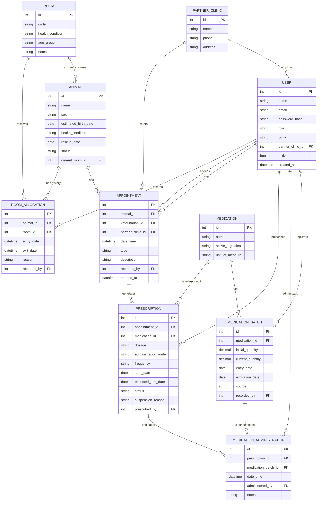

# Especificações do Projeto

Pré-requisitos: <a href="01-Documentação de Contexto.md"> Documentação de Contexto</a>

Definição do problema e ideia de solução a partir da perspectiva do usuário.

A solução proposta para a **ONG Amicats** substitui as fichas de papel afixadas nas portas das oito salas do abrigo por um prontuário digital acessível pelo celular, contemplando ainda o controle de medicações, a alocação dos animais por sala e o ciclo de adoção. A especificação a seguir foi construída a partir de entrevista em profundidade com as representantes da organização e da observação do processo manual em uso.

## Usuários

| Tipo de Usuário | Descrição | Responsabilidades |
|------------------|-----------|------------------|
| **Administrador** | Fundadora e responsáveis pela gestão do abrigo. Acumulam administração, finanças e coordenação clínica. | Cadastrar usuários e definir perfis; criar e desativar salas; cadastrar gatos; inserir no sistema os prontuários recebidos das clínicas parceiras; gerar relatórios; acessar todos os módulos. |
| **Médico-Veterinário** | Profissionais contratados que atendem no abrigo em escala alternada (segundas, quartas e sextas; terças e quintas). | Cadastrar prescrições no prontuário; registrar doses administradas; suspender medicações informando o motivo; agendar e registrar vacinas e castrações; consultar o histórico clínico completo. |
| **Auxiliar** | Voluntários e caseiros que atuam nos cuidados diários dos animais. | Consultar fichas, prontuários e situação dos medicamentos; registrar a administração de doses já prescritas; atualizar a sala em que o gato se encontra; cadastrar fotos. |
| **Visualizador** | Colaboradores externos e apoiadores com acesso restrito à consulta. | Consultar fichas e histórico clínico, sem qualquer permissão de escrita. |

## Arquitetura e Tecnologias

A arquitetura foi definida priorizando simplicidade e sustentabilidade de manutenção pela própria ONG, em linha com a restrição de orçamento praticamente nulo e a ausência de equipe técnica. Não há microsserviços, filas de mensagens ou múltiplos bancos de dados: um único backend e um único banco relacional atendem os dois clientes (mobile e web). O ponto central do desenho é separar claramente o que precisa funcionar **offline**, dentro do abrigo, do que funciona **online**, fora dele.

- **App Mobile (React Native)** — usado no abrigo pelos voluntários e veterinários no dia a dia do atendimento. Funciona **offline-first**: todo lançamento de prontuário, medicação e alocação de sala é gravado primeiro em um banco local (SQLite) no próprio celular. Quando há sinal (mesmo instável), o app sincroniza em segundo plano com o backend, enviando as alterações pendentes e baixando o que foi atualizado por outros dispositivos.
- **Backend (Java / Spring Boot)** — fonte única de verdade dos dados. Expõe uma API REST consumida tanto pelo app mobile (via sincronização) quanto pela web (uso direto, sempre online). Concentra a lógica de negócio, autenticação e o registro de autor/data-hora exigido pela Resolução CFMV nº 1.321/2020.
- **Banco de Dados (PostgreSQL)** — banco relacional único, hospedado na nuvem junto ao backend, armazenando prontuários, medicações, estoque e alocação das salas.
- **Web App (Next.js)** — utilizado pela administração/coordenação e pelas clínicas parceiras, sempre a partir de locais com internet estável (fora do abrigo). Por isso não precisa de suporte offline, apenas de conexão direta e online com a API.
- **Sincronização** — cada dispositivo mobile mantém uma fila local de alterações pendentes; ao reconectar, envia essas alterações ao backend e recebe o que mudou desde a última sincronização. Cada registro carrega autor e timestamp, e a resolução de conflitos é feita por **acréscimo, nunca por sobrescrita**: um ajuste posterior gera um novo lançamento em vez de substituir o registro existente, preservando o histórico auditável exigido para o prontuário e atendendo ao RNF-004 (nenhuma edição silenciosa).

## Project Model Canvas

Deve ser desenvolvido a partir do microfundamento: Empreendedorismo e inovação.

| Bloco | Conteúdo |
|---|---|
| **Justificativas** | Registro clínico em papel que se perde; ausência de continuidade entre veterinários da escala alternada; falta de controle de medicações e estoque; deslocamentos e compras duplicadas; exigência de guarda de prontuário pela Resolução CFMV nº 1.321/2020. |
| **Objetivo SMART** | Entregar, até 06/12/2026, um sistema web e mobile em produção na ONG Amicats, com prontuário digital, controle de medicações e alocação por sala operando offline. |
| **Benefícios** | Rastreabilidade do histórico clínico; continuidade assistencial entre profissionais; redução de viagens e compras duplicadas; histórico auditável para prestação de contas. |
| **Produto** | Aplicação mobile, painel web e API REST, com base de dados centralizada em nuvem. |
| **Requisitos** | Ver seção Requisitos. |
| **Stakeholders** | Fundadora e administração da ONG; médicos-veterinários contratados; voluntários; clínicas parceiras; adotantes; equipe de desenvolvimento; docente orientador. |
| **Equipe** | Seis estudantes de ADS, organizados segundo papéis inspirados no Scrum. |
| **Premissas** | Disponibilidade da ONG para validação periódica; uso de celulares pessoais dos voluntários; existência de ao menos janelas intermitentes de conexão. |
| **Restrições** | Ver seção Restrições. |
| **Riscos** | Baixa aderência da equipe do abrigo ao registro digital; perda de dados antes da sincronização; rotatividade de voluntários; prazo letivo fixo. |
| **Entregas** | Documentação e requisitos (Etapa 1); protótipo e cadastros base (Etapa 2); núcleo clínico (Etapa 3); adoção e gestão (Etapa 4); homologação e implantação (Etapa 5). |

> **Links Úteis**:
> Disponíveis em material de apoio do projeto

## Requisitos

As tabelas que se seguem apresentam os requisitos funcionais e não funcionais que detalham o escopo do projeto.

**Técnica de priorização aplicada — MoSCoW.** Os requisitos foram classificados em quatro categorias a partir das dores relatadas pela organização e da dependência técnica entre funcionalidades:

- **Must Have (ALTA)** — sem estes o sistema não resolve o problema que motivou o projeto. Reúne autenticação e perfis, cadastros base, prontuário, administração de medicamentos e operação offline. Corresponde ao que a ONG identificou como mais urgente: substituir o papel na parede e viabilizar o registro dentro do abrigo, onde não há conexão.
- **Should Have (MÉDIA)** — agregam valor relevante, mas o sistema entra em operação sem eles. Reúne adoção, devolução, vacinas, banco de voluntários, controle de disponibilidade de medicamentos e dashboard.
- **Could Have (BAIXA)** — desejáveis, implementados apenas se houver folga de cronograma. Reúne exportação de relatórios e aceite de termos.
- **Won't Have** — explicitamente fora do escopo desta versão, registrado na tabela de Restrições: assistente por IA ou chat para consulta de dados, acesso direto de profissionais externos e controle de estoque de ração e insumos.

A **complexidade** foi estimada pela equipe considerando esforço de implementação, volume de regras de negócio e dependência de infraestrutura externa.

### Requisitos Funcionais

|ID    | Descrição do Requisito | Prioridade | Etapa | Responsável | Complexidade |
|------|------------------------|:----:|:----:|:----:|:----:|
|RF-001| Permitir autenticação de usuários por login e senha, com recuperação por e-mail ou redefinição pelo Administrador | ALTA | Etapa 2 | | Média |
|RF-002| Disponibilizar perfis de acesso distintos (Administrador, Médico-Veterinário, Auxiliar e Visualizador) com permissões próprias | ALTA | Etapa 2 | | Alta |
|RF-003| Exibir aceite de termos de uso no primeiro login, registrando data e hora | BAIXA | Etapa 4 | | Baixa |
|RF-004| Permitir o cadastro e a edição de usuários do sistema, com foto, nome completo, telefone, e-mail e tipo de acesso | MÉDIA | Etapa 2 | | Baixa |
|RF-005| Permitir o cadastro do banco de contatos voluntários, com área de atuação, disponibilidade, carona e situação (ativo/inativo) | MÉDIA | Etapa 4 | | Baixa |
|RF-006| Permitir o cadastro e a edição de salas pela interface, com título, descrição, foto de capa e status | ALTA | Etapa 2 | | Baixa |
|RF-007| Permitir o cadastro completo do gato, com vínculo à sala atual e registro do histórico de transferências | ALTA | Etapa 2 | | Alta |
|RF-008| Permitir a captura de foto pela câmera do dispositivo e o upload de múltiplas imagens por gato | ALTA | Etapa 2 | | Média |
|RF-009| Permitir o cadastro de prescrição no prontuário, com diagnóstico, veterinário, CRMV/UF, data, local, medicação, status e anexos | ALTA | Etapa 3 | | Alta |
|RF-010| Exibir o histórico clínico completo do gato em ordem cronológica, com detalhamento por registro | ALTA | Etapa 3 | | Média |
|RF-011| Permitir o registro de atendimento realizado em clínica externa, com anexo do prontuário fornecido pelo parceiro | MÉDIA | Etapa 3 | | Média |
|RF-012| Permitir a marcação da dose administrada, com responsável, data e hora, e a suspensão da medicação com motivo | ALTA | Etapa 3 | | Alta |
|RF-013| Permitir o controle de disponibilidade de medicamentos, com status, doador e validade | MÉDIA | Etapa 3 | | Média |
|RF-014| Permitir o agendamento e o registro de vacinas e castrações, com data prevista e data realizada | MÉDIA | Etapa 4 | | Baixa |
|RF-015| Permitir o registro de adoção, com dados do adotante, observações da entrega, data de revisitação e anexo do termo | MÉDIA | Etapa 4 | | Média |
|RF-016| Permitir o registro de devolução, com gato, adotante, data, motivo e anexos, retornando o animal ao registro ativo | MÉDIA | Etapa 4 | | Média |
|RF-017| Exibir dashboard inicial com lembretes de vacinas e castrações da semana, totais por sala e novos cadastros | MÉDIA | Etapa 4 | | Média |
|RF-018| Disponibilizar campo de busca por palavra-chave nas listagens e na página inicial | ALTA | Etapa 3 | | Baixa |
|RF-019| Permitir a exportação de relatórios em tela, PDF ou Excel | BAIXA | Etapa 4 | | Média |
|RF-020| Manter os dados em edição salvos localmente e sincronizá-los com o servidor de forma automática ou manual | ALTA | Etapa 3 | | Alta |

### Requisitos não Funcionais

|ID | Descrição do Requisito | Prioridade |
|-------|-------------------------|:----:|
|RNF-001| O sistema deve ser responsivo, com uso prioritariamente mobile e acesso web complementar | ALTA |
|RNF-002| A aplicação deve operar sob conectividade intermitente, mantendo os dados localmente até a sincronização | ALTA |
|RNF-003| O sistema deve suportar múltiplos usuários simultâneos sem conflito de dados | ALTA |
|RNF-004| Todo registro clínico deve preservar autor, data e hora, sem permitir edição silenciosa | ALTA |
|RNF-005| Nenhum registro pode ser excluído fisicamente; a exclusão deve ser lógica, por desativação | ALTA |
|RNF-006| A aplicação deve estar em conformidade com a LGPD, restringindo por perfil o acesso a dados de adotantes e voluntários | ALTA |
|RNF-007| A interface deve ser operável por voluntários sem formação técnica, com fluxos curtos e linguagem simples | ALTA |
|RNF-008| As telas de consulta devem responder em até 3 segundos em rede móvel 4G | MÉDIA |
|RNF-009| Os prontuários devem ser mantidos por no mínimo 5 anos, conforme Resolução CFMV nº 1.321/2020 | MÉDIA |
|RNF-010| O sistema deve realizar backup automático diário dos registros e das imagens | MÉDIA |
|RNF-011| A solução deve ter baixo custo de hospedagem e manutenção, compatível com o orçamento de uma ONG | ALTA |
|RNF-012| O sistema deve apresentar disponibilidade mínima de 99% do tempo | MÉDIA |
|RNF-013| As senhas devem ser armazenadas com hash e o tráfego deve ocorrer exclusivamente sobre HTTPS | ALTA |

## Restrições

O projeto está restrito pelos itens apresentados na tabela a seguir.

|ID| Restrição |
|--|-------------------------------------------------------|
|01| O projeto deverá ser entregue até o final do semestre letivo (06/12/2026) |
|02| O abrigo não possui internet fixa nem computadores; o cabeamento é economicamente inviável e a cobertura móvel é instável |
|03| Os registros serão feitos em celulares pessoais dos voluntários, sem dispositivos fornecidos pela organização |
|04| Profissionais externos e clínicas parceiras não receberão acesso ao sistema; suas informações serão inseridas por um usuário interno designado |
|05| A ONG não recebe auxílio governamental, o que restringe a solução a ferramentas gratuitas ou de custo mínimo |
|06| O uso da câmera e do armazenamento local depende de permissão explícita concedida pelo usuário no dispositivo |
|07| A identidade visual deve manter o nome, a logo e a paleta já utilizados pela organização |
|08| Assistente por IA ou chat para consulta de dados está fora do escopo desta versão |
|09| O controle de estoque de ração e demais insumos não integra esta versão |

> **Links Úteis**:
> - [O que são Requisitos Funcionais e Requisitos Não Funcionais?](https://codificar.com.br/requisitos-funcionais-nao-funcionais/)
> - [O que são requisitos funcionais e requisitos não funcionais?](https://analisederequisitos.com.br/requisitos-funcionais-e-requisitos-nao-funcionais-o-que-sao/)

## Diagrama de Caso de Uso

### Atores

| Ator | Descrição |
|---|---|
| **Administrador** | Gestão da ONG. Ator com acesso total ao sistema; herda todas as ações dos demais atores. |
| **Médico-Veterinário** | Profissional responsável pela conduta clínica; único ator autorizado a prescrever. |
| **Auxiliar** | Voluntário ou caseiro que executa os cuidados diários e registra a administração das doses prescritas. |
| **Visualizador** | Colaborador externo com permissão apenas de consulta. |
| **Serviço de Sincronização** | Ator secundário (sistema). Detecta conectividade e envia à API a fila de operações registradas offline. |

### Casos de Uso

| ID | Caso de Uso | Ator Principal | Descrição Sucinta | RF |
|---|---|---|---|---|
| UC-01 | Autenticar no sistema | Todos | Usuário informa credenciais e obtém acesso conforme o perfil atribuído. | RF-001, RF-002 |
| UC-02 | Aceitar termos de uso | Todos | No primeiro acesso, o usuário registra o aceite, com data e hora. *«extends» UC-01* | RF-003 |
| UC-03 | Gerenciar usuários | Administrador | Cadastra, edita e desativa usuários, definindo o tipo de acesso. | RF-004 |
| UC-04 | Gerenciar voluntários | Administrador | Mantém a lista de contatos voluntários por área de atuação e situação. | RF-005 |
| UC-05 | Gerenciar salas | Administrador | Cria, edita e desativa salas do abrigo pela interface. | RF-006 |
| UC-06 | Gerenciar cadastro do gato | Administrador, Médico-Veterinário | Cadastra e edita a ficha do felino, incluindo status de saúde e características. | RF-007 |
| UC-07 | Registrar fotografia do animal | Administrador, Médico-Veterinário, Auxiliar | Captura pela câmera ou envia imagens vinculadas à ficha do gato. *«extends» UC-06* | RF-008 |
| UC-08 | Transferir gato de sala | Administrador, Auxiliar | Altera a sala atual do animal, gerando registro no histórico de transferências. | RF-007 |
| UC-09 | Registrar prescrição | Médico-Veterinário | Cadastra diagnóstico e medicação prescrita, com CRMV, dosagem, via e duração. | RF-009 |
| UC-10 | Consultar histórico clínico | Todos | Visualiza em ordem cronológica os registros do prontuário do animal. | RF-010 |
| UC-11 | Anexar prontuário de clínica externa | Administrador | Registra o atendimento realizado em clínica parceira e anexa o documento recebido. | RF-011 |
| UC-12 | Registrar administração de dose | Médico-Veterinário, Auxiliar | Marca a dose aplicada, gravando responsável, data e hora. *«include» UC-09* | RF-012 |
| UC-13 | Suspender medicação | Médico-Veterinário | Interrompe um tratamento em curso informando obrigatoriamente o motivo. *«extends» UC-09* | RF-012 |
| UC-14 | Controlar disponibilidade de medicamentos | Administrador, Auxiliar | Atualiza e consulta a situação dos medicamentos, com doador e validade. | RF-013 |
| UC-15 | Gerenciar vacinas e castrações | Administrador, Médico-Veterinário | Agenda e registra a realização de vacinas e castrações. | RF-014 |
| UC-16 | Registrar adoção | Administrador | Cadastra a adoção com dados do adotante e anexo do termo de responsabilidade. *«include» UC-06* | RF-015 |
| UC-17 | Registrar devolução | Administrador | Cadastra a devolução com motivo e anexos, retornando o animal ao registro ativo. *«extends» UC-16* | RF-016 |
| UC-18 | Consultar dashboard | Todos | Visualiza lembretes da semana, totais por sala e novos cadastros. | RF-017 |
| UC-19 | Buscar por palavra-chave | Todos | Localiza gatos e registros a partir de termo digitado. | RF-018 |
| UC-20 | Exportar relatório | Administrador | Gera em tela, PDF ou Excel os relatórios de ficha, prescrições, vacinas e castrações. | RF-019 |
| UC-21 | Sincronizar dados offline | Serviço de Sincronização | Envia à API a fila de operações registradas sem conexão e confirma a gravação. | RF-020 |

> **Links Úteis**:
> - [Criando Casos de Uso](https://www.ibm.com/docs/pt-br/elm/6.0?topic=requirements-creating-use-cases)
> - [Como Criar Diagrama de Caso de Uso: Tutorial Passo a Passo](https://gitmind.com/pt/fazer-diagrama-de-caso-uso.html/)
> - [Lucidchart](https://www.lucidchart.com/)
> - [Astah](https://astah.net/)
> - [Diagrams](https://app.diagrams.net/)

## Modelo da Base de Dados

Banco de dados relacional (PostgreSQL, conforme definido em [Arquitetura e Tecnologias](#arquitetura-e-tecnologias)). O modelo cobre o escopo priorizado na Fase 1 do projeto: prontuário clínico, controle de medicações (prescrição, administração e estoque) e alocação dos animais por sala.

### MER (Modelo Entidade-Relacionamento)

**Decisões de modelagem:**

- **`room_allocation` como histórico, separado de `animal.current_room_id`.** Os gatos são realocados com frequência entre salas conforme evolução do quadro clínico; o histórico completo é mantido em `room_allocation` (com `exit_date` nulo representando a alocação vigente), enquanto `animal.current_room_id` guarda a posição atual para consulta rápida sem precisar varrer o histórico.
- **`medication_administration` separado de `prescription`.** Uma prescrição define o que deve ser administrado (dosagem, frequência, período); cada dose efetivamente aplicada gera um registro próprio, com autor e horário — isso resolve diretamente a dor relatada de não ser possível confirmar o que já foi dado em um turno anterior.
- **`medication_batch` controla o estoque por lote, não só por medicamento.** Cada lote tem validade e quantidade próprias; `medication_administration` pode referenciar o lote consumido, permitindo abater o estoque automaticamente e alertar sobre vencimento.
- **`appointment` distingue quem atendeu de quem registrou.** O veterinário responsável (`veterinarian_id`) pode ser diferente de quem lançou o registro no sistema (`recorded_by`), já que muitas vezes um voluntário digitaliza depois o que foi passado verbalmente — sem perder a rastreabilidade de autoria exigida pela Resolução CFMV.
- **`user.crmv` e `partner_clinic`.** Atendem à exigência de identificar o médico-veterinário responsável (nome e CRMV) em cada registro, incluindo os casos encaminhados às três clínicas parceiras externas.

### Projeto Físico da Base de Dados

_A detalhar em etapa seguinte: estrutura definitiva das tabelas, tipos de dados exatos, índices e constraints, a partir do MER acima._
