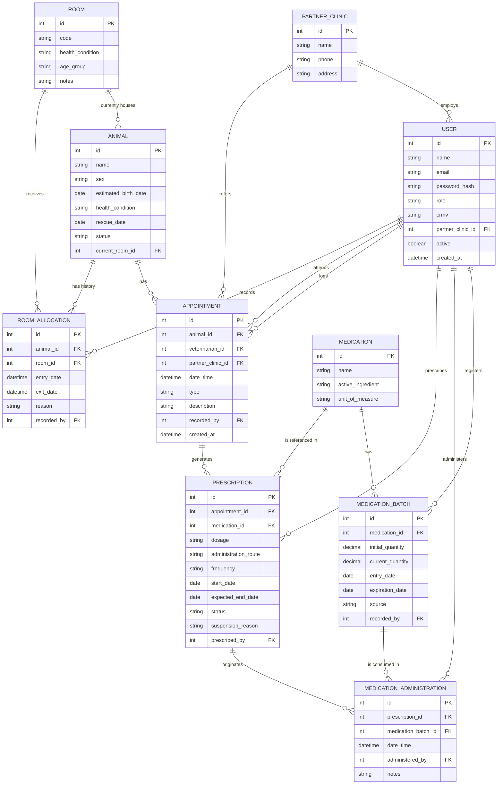

# Especificações do Projeto

Pré-requisitos: <a href="01-Documentação de Contexto.md"> Documentação de Contexto</a>

Definição do problema e ideia de solução a partir da perspectiva do usuário. 

## Usuários
| Tipo de Usuário   | Descrição | Responsabilidades |
|------------------|-----------|------------------|
| **xxx** | xxxxx | xxxxx |

### Exemplo

| Tipo de Usuário   | Descrição | Responsabilidades |
|------------------|-----------|------------------|
| **Administrador** | Gerencia a aplicação e os usuários. | Gerenciar usuários, configurar o sistema, acessar todos os relatórios. |
| **Funcionário** | Usa a aplicação para suas tarefas principais. | Criar e editar registros, visualizar relatórios. |

## Arquitetura e Tecnologias

A arquitetura foi definida priorizando simplicidade e sustentabilidade de manutenção pela própria ONG, em linha com a restrição de orçamento praticamente nulo e a ausência de equipe técnica. Não há microsserviços, filas de mensagens ou múltiplos bancos de dados: um único backend e um único banco relacional atendem os dois clientes (mobile e web). O ponto central do desenho é separar claramente o que precisa funcionar **offline**, dentro do abrigo, do que funciona **online**, fora dele.

- **App Mobile (React Native)** — usado no abrigo pelos voluntários e veterinários no dia a dia do atendimento. Funciona **offline-first**: todo lançamento de prontuário, medicação e alocação de sala é gravado primeiro em um banco local (SQLite) no próprio celular. Quando há sinal (mesmo instável), o app sincroniza em segundo plano com o backend, enviando as alterações pendentes e baixando o que foi atualizado por outros dispositivos.
- **Backend (Java / Spring Boot)** — fonte única de verdade dos dados. Expõe uma API REST consumida tanto pelo app mobile (via sincronização) quanto pela web (uso direto, sempre online). Concentra a lógica de negócio, autenticação e o registro de autor/data-hora exigido pela Resolução CFMV nº 1.321/2020.
- **Banco de Dados (PostgreSQL)** — banco relacional único, hospedado na nuvem junto ao backend, armazenando prontuários, medicações, estoque e alocação das salas.
- **Web App (Next.js)** — utilizado pela administração/coordenação e pelas clínicas parceiras, sempre a partir de locais com internet estável (fora do abrigo). Por isso não precisa de suporte offline, apenas de conexão direta e online com a API.
- **Sincronização** — cada dispositivo mobile mantém uma fila local de alterações pendentes; ao reconectar, envia essas alterações ao backend e recebe o que mudou desde a última sincronização. Cada registro carrega autor e timestamp, o que permite resolução simples de conflitos (last write wins) e preserva o histórico auditável exigido para o prontuário.

## Project Model Canvas

Deve ser desenvolvido a partir do microfundamento: Empreendedorismo e inovação.
Colocar a imagem do modelo construído apresentando a proposta de solução.

> **Links Úteis**:
> Disponíveis em material de apoio do projeto

## Requisitos

As tabelas que se seguem apresentam os requisitos funcionais e não funcionais que detalham o escopo do projeto. Para determinar a prioridade de requisitos, aplicar uma técnica de priorização de requisitos e detalhar como a técnica foi aplicada.

Para mais informações, consulte os microfundamentos Fundamentos de Engenharia de Software e Engenharia de Requisitos de Software. 

### Requisitos Funcionais

|ID    | Descrição do Requisito  | Prioridade | Etapa |Responsável |Complexidade |
|------|-----------------------------------------|----|----|----|----|
|RF-001| Permitir que o usuário cadastre tarefas | ALTA | Etapa 1 | Maria | Alta |
|RF-002| Emitir um relatório de tarefas no mês   | MÉDIA |Etapa 2 | João | Média | 

### Requisitos não Funcionais

|ID     | Descrição do Requisito  |Prioridade |
|-------|-------------------------|----|
|RNF-001| O sistema deve ser responsivo para rodar em um dispositivos móvel | MÉDIA | 
|RNF-002| Deve processar requisições do usuário em no máximo 3s |  BAIXA | 

Com base nas Histórias de Usuário, enumere os requisitos da sua solução. Classifique esses requisitos em dois grupos:

- [Requisitos Funcionais
 (RF)](https://pt.wikipedia.org/wiki/Requisito_funcional):
 correspondem a uma funcionalidade que deve estar presente na
  plataforma (ex: cadastro de usuário).
- [Requisitos Não Funcionais
  (RNF)](https://pt.wikipedia.org/wiki/Requisito_n%C3%A3o_funcional):
  correspondem a uma característica técnica, seja de usabilidade,
  desempenho, confiabilidade, segurança ou outro (ex: suporte a
  dispositivos iOS e Android).
Lembre-se que cada requisito deve corresponder à uma e somente uma
característica alvo da sua solução. Além disso, certifique-se de que
todos os aspectos capturados nas Histórias de Usuário foram cobertos.

## Restrições

O projeto está restrito pelos itens apresentados na tabela a seguir.

|ID| Restrição                                             |
|--|-------------------------------------------------------|
|01| O projeto deverá ser entregue até o final do semestre |
|02| Não pode ser desenvolvido um módulo de backend        |

Enumere as restrições à sua solução. Lembre-se de que as restrições geralmente limitam a solução candidata.

> **Links Úteis**:
> - [O que são Requisitos Funcionais e Requisitos Não Funcionais?](https://codificar.com.br/requisitos-funcionais-nao-funcionais/)
> - [O que são requisitos funcionais e requisitos não funcionais?](https://analisederequisitos.com.br/requisitos-funcionais-e-requisitos-nao-funcionais-o-que-sao/)

## Diagrama de Caso de Uso

O diagrama de casos de uso é o próximo passo após a elicitação de requisitos, que utiliza um modelo gráfico e uma tabela com as descrições sucintas dos casos de uso e dos atores. Ele contempla a fronteira do sistema e o detalhamento dos requisitos funcionais com a indicação dos atores, casos de uso e seus relacionamentos. 

Para mais informações, consulte o microfundamento Engenharia de Requisitos de Software 

As referências abaixo irão auxiliá-lo na geração do artefato “Diagrama de Casos de Uso”.

> **Links Úteis**:
> - [Criando Casos de Uso](https://www.ibm.com/docs/pt-br/elm/6.0?topic=requirements-creating-use-cases)
> - [Como Criar Diagrama de Caso de Uso: Tutorial Passo a Passo](https://gitmind.com/pt/fazer-diagrama-de-caso-uso.html/)
> - [Lucidchart](https://www.lucidchart.com/)
> - [Astah](https://astah.net/)
> - [Diagrams](https://app.diagrams.net/)

## Modelo da Base de Dados

Banco de dados relacional (PostgreSQL, conforme definido em [Arquitetura e Tecnologias](#arquitetura-e-tecnologias)). O modelo cobre o escopo priorizado na Fase 1 do projeto: prontuário clínico, controle de medicações (prescrição, administração e estoque) e alocação dos animais por sala.

### MER (Modelo Entidade-Relacionamento)

**Decisões de modelagem:**

- **`room_allocation` como histórico, separado de `animal.current_room_id`.** Os gatos são realocados com frequência entre salas conforme evolução do quadro clínico; o histórico completo é mantido em `room_allocation` (com `exit_date` nulo representando a alocação vigente), enquanto `animal.current_room_id` guarda a posição atual para consulta rápida sem precisar varrer o histórico.
- **`medication_administration` separado de `prescription`.** Uma prescrição define o que deve ser administrado (dosagem, frequência, período); cada dose efetivamente aplicada gera um registro próprio, com autor e horário — isso resolve diretamente a dor relatada de não ser possível confirmar o que já foi dado em um turno anterior.
- **`medication_batch` controla o estoque por lote, não só por medicamento.** Cada lote tem validade e quantidade próprias; `medication_administration` pode referenciar o lote consumido, permitindo abater o estoque automaticamente e alertar sobre vencimento.
- **`appointment` distingue quem atendeu de quem registrou.** O veterinário responsável (`veterinarian_id`) pode ser diferente de quem lançou o registro no sistema (`recorded_by`), já que muitas vezes um voluntário digitaliza depois o que foi passado verbalmente — sem perder a rastreabilidade de autoria exigida pela Resolução CFMV.
- **`user.crmv` e `partner_clinic`.** Atendem à exigência de identificar o médico-veterinário responsável (nome e CRMV) em cada registro, incluindo os casos encaminhados às três clínicas parceiras externas.

### Projeto Físico da Base de Dados

_A detalhar em etapa seguinte: estrutura definitiva das tabelas, tipos de dados exatos, índices e constraints, a partir do MER acima._

